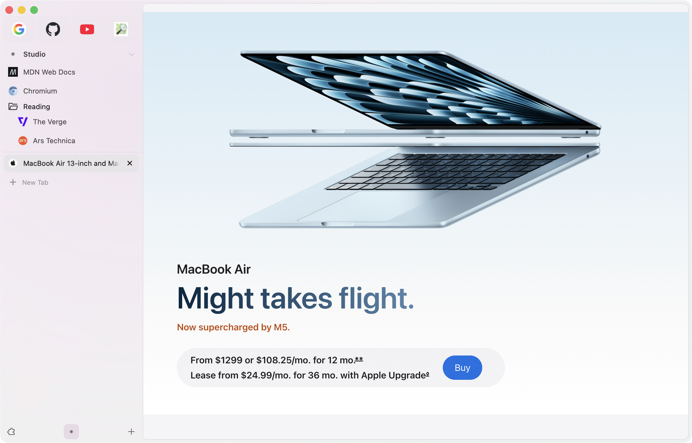
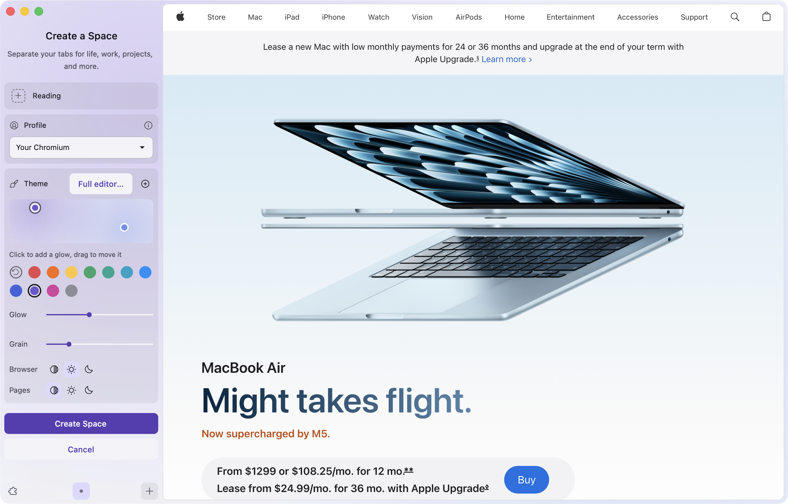

# Arcium

Helium's privacy and speed, with Arc-inspired polish.

Arcium adds Spaces, Pins, Favorites, Peek, Little Arc, and a customizable macOS sidebar to [Helium](https://helium.computer/). Keep the browsing engine and extensions you know, then shape the workspace around your pages.



The preview includes the glass, sidebar, and command bar shown here.

[Download the preview](https://github.com/dr-baker/Arcium-macOS/releases) · [Changelog](CHANGELOG.md) · [Install and limits](docs/preview-release.md) · [Import from Arc](docs/import-from-arc.md) · [Build from source](docs/building.md)

## Start browsing

Apple Silicon · macOS 26 or later

1. Download the DMG, open **Install Arcium**, and click **Install**.
2. Finish the first-run setup, then press **Command-Comma** for native Settings.
3. Coming from Arc? Follow the [import guide](docs/import-from-arc.md) before bringing over your sidebar.

New profiles start with a pastel sidebar, a hidden address bar, Peek, recent-tab cycling, and Little Arc. Press **Command-L** whenever you need an address. Existing profiles keep their settings. This is an early preview with manual updates; read the [release limits](docs/preview-release.md) before everyday use.

## What's next

- **Pinned split views.** Finish validating saved pairs, layout restoration, and closing both panes as one item.
- **A Shelf-inspired alternative to auto-archiving.** Put tabs aside without losing track of them.
- **Little Arc + Peek.** Bring external links and in-browser previews into one interaction.
- **Local LLM tab cleanup.** Help sort an overcrowded workspace with a local model.
- **Browser control for agents.** Build an efficient interface for agents to operate the browser.

These are planned directions. Chromium updates and release reliability come first.

## Make it yours

Choose a sidebar layout and collapse behavior, move navigation, or hide the top bar. Give Spaces their own colors, then adjust grain, glass, borders, and browser UI scale without changing webpage zoom.

There are separate material, tint, and opacity controls for command bars and floating controls, and for the recent-tab switcher and Peek. Peek's backdrop has its own blur and dimming controls.


## One command bar

Press **Command-T** to find tabs, Pins, Favorites, or a new page. Choose YouTube to search videos or ChatGPT to start a fresh chat. Soft scope colors spill down into the glass. Omni blends violet, blue, and mint.


## Pins, Favorites, and Spaces

Local Favorites are shared across a profile. Imported Arc Favorites appear in Spaces belonging to their Arc source profile. Pins and folders belong to a Space. A Pin remembers its home page after you follow links, and closing its live tab leaves the saved item in the sidebar.

Create Spaces for work, reading, or a project, each with its own Pins and styling. Spaces inside one profile share cookies and sign-ins. Use separate browser profiles for separate accounts.



## Find the tab you just used

Hold **Control** and press **Tab** to preview recent tabs. Keyboard Shortcuts also offers explicit Recent Tab actions and an Arc-inspired preset.


## Peek and Little Arc

Peek opens eligible links over the page you're reading. You can also choose it from a link's context menu, then promote the preview to a tab or sidebar item.


Little Arc opens a link from another app in a compact window. It currently handles one eligible HTTP or HTTPS link per request. Opening an empty Little Arc search window by shortcut is not implemented.


## The Helium foundation

Arcium keeps Helium's ad and tracker blocking, fingerprinting protections, Chromium extensions, and split views. The work here focuses on the sidebar, tab workflow, and native macOS integration.

## Source and development

This is the main macOS product repository. It pins [Arcium core](https://github.com/dr-baker/Arcium) in `helium-chromium/` and owns macOS integration, packaging, and signing. The temporary Arcium-browser repository is retired; current downloads and documentation live here.

```sh
git clone --recurse-submodules https://github.com/dr-baker/Arcium-macOS.git
cd Arcium-macOS
```

Continue with the [build guide](docs/building.md). For daily use, see the [quickstart](docs/arc-quickstart.md), [Arc import guide](docs/import-from-arc.md), and [advanced credential migration](docs/arc-daily-driver-migration.md). Developers can follow the [agent workflow](docs/agent-workflow.md), [parallel work rules](docs/parallel-work.md), and [feature settings contracts](docs/feature-settings-audit.md).

Arcium is independent of The Browser Company. It descends from [Helium for macOS](https://github.com/imputnet/helium-macos) and [ungoogled-chromium-macos](https://github.com/ungoogled-software/ungoogled-chromium-macos). Original Arcium additions are [GPL-3.0](LICENSE); imported code keeps its original licenses.
