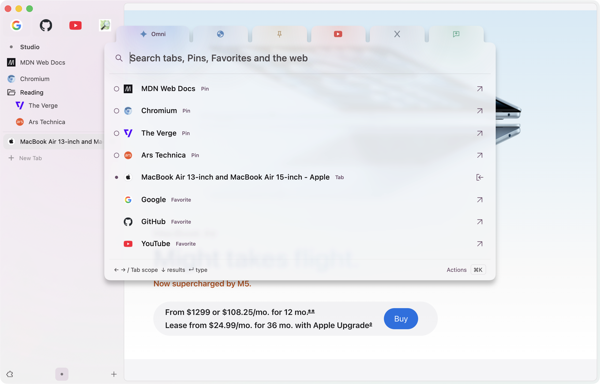
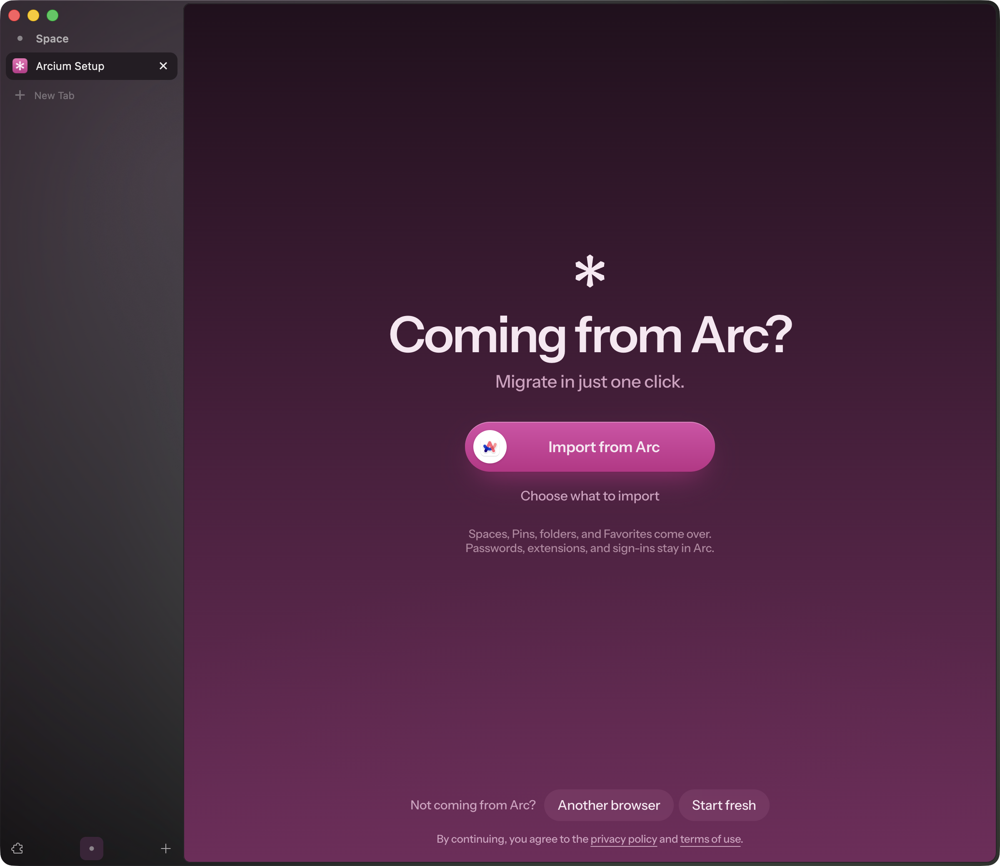
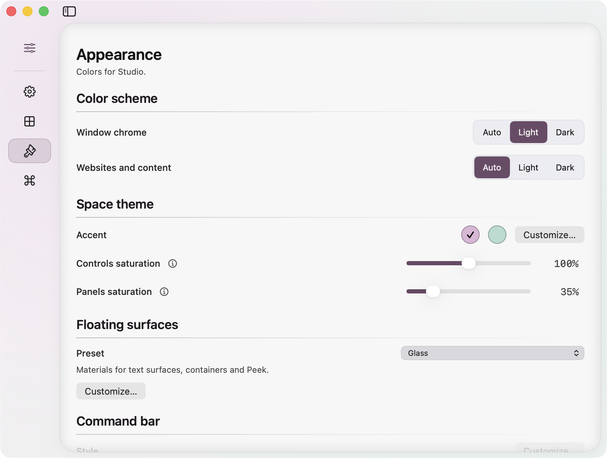
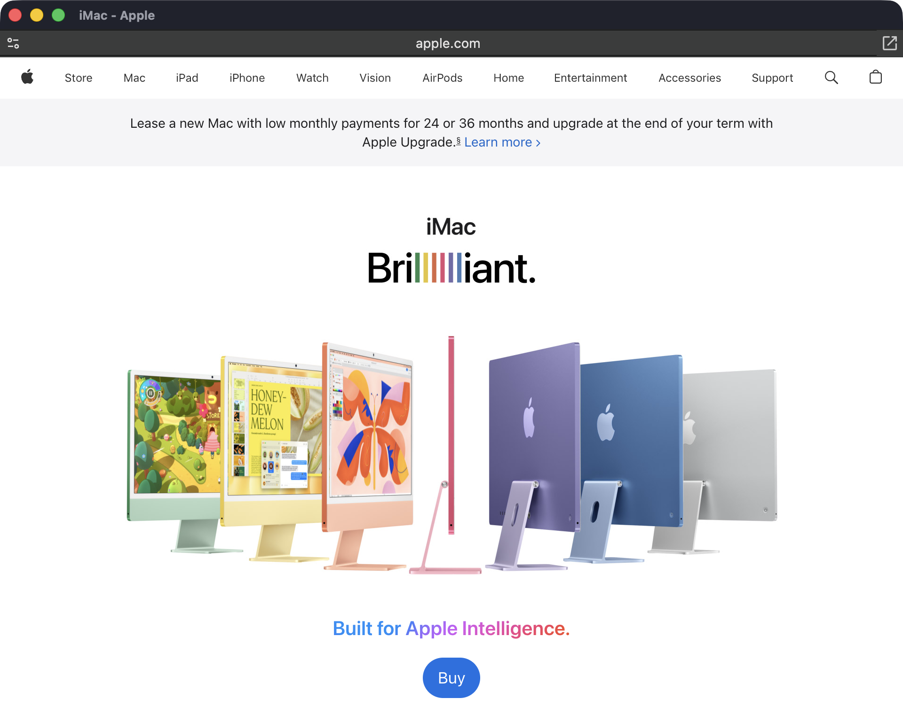

# Arcium

**Helium's privacy and speed, with Arc polish.**

A browser for people who love a good sidebar. Built on [Helium](https://helium.computer/), with Spaces, Pins, Favorites, Peek, and glass you can make your own.

**[Download for Mac](https://github.com/dr-baker/Arcium-macOS/releases/download/0.2.0-preview.1/Arcium-0.2.0-preview.1-macOS-arm64.dmg)** · [RIP Arc: release notes](https://github.com/dr-baker/Arcium-macOS/releases/tag/0.2.0-preview.1) · [Quickstart](docs/arc-quickstart.md)

Apple Silicon · macOS 26+ · Preview.1 · Manual updates

## Moving on from Arc?

Keep the workflow you came for: Spaces, pinned pages, Favorites, and a sidebar that feels like home. [Bring your Arc sidebar](docs/import-from-arc.md), then make Arcium yours.

**Next release: migrate in just one click.** The new welcome screen brings over available Spaces, their icons, Pins, folders, and Favorites. Choose specific Spaces if you prefer; Arcium handles their attached profiles. Then **Start browsing**, or **Customize appearance**.

One-click setup is merged but not in the preview.1 download. That version uses the [Arc import dialog](docs/import-from-arc.md#advanced-import). Passwords and sign-ins need [separate migration](docs/import-from-arc.md#passwords-and-cookies).

## The omnibox, built out

Keep the omnibox's address entry, suggestions, and search. Arcium adds a glass command bar for tabs, Pins, and Favorites, plus site-search scopes: search YouTube, find something on X, or send a question to a new ChatGPT chat. Press **Command-T** to begin.

## Your browser, your workspace

Give each Space its own colors and Pins. Customize glass, move the sidebar, or hide the address bar. Keep Favorites close, save split views as Pins, and use **Control-Tab** to return to recently used tabs.

## A quick look, without losing your place

**Peek** previews a link over your current page. **Little Arc** opens links from other apps in a compact window. Keep reading, or turn the page into a tab or Pin.

## Start browsing

1. Open the download, open **Install Arcium**, and click **Install**.
2. Finish setup, then [import from Arc](docs/import-from-arc.md) if you're switching.
3. Browse. **Command-L** opens the command bar; **Command-Comma** opens Settings.

New profiles start with pastel colors and a hidden address bar. Existing profiles keep their settings. Read the [preview limits](docs/preview-release.md#limits), including the older Chromium base, before everyday use.

## What's next

**Next release:** one-click Arc migration, original Space icons, clearer split Pins, and independent System appearance for the browser and pages. [Changelog](CHANGELOG.md)

**On the roadmap:** a Shelf-inspired alternative to auto-archiving; Little Arc and Peek brought together; local LLM tab cleanup; efficient browser control for agents. Chromium updates and release reliability come first.

## Open source, built on Helium

Helium supplies ad and tracker blocking, fingerprinting protections, Chromium extensions, and split views. Arcium builds on that foundation with its own workspace and native macOS controls.

[Arcium core](https://github.com/dr-baker/Arcium) owns shared behavior; this repository packages the Mac app. [Build from source](docs/building.md) with `git clone --recurse-submodules https://github.com/dr-baker/Arcium-macOS.git`.

Independent of The Browser Company. Descended from [Helium for macOS](https://github.com/imputnet/helium-macos) and [ungoogled-chromium-macos](https://github.com/ungoogled-software/ungoogled-chromium-macos). Original Arcium additions are [GPL-3.0](LICENSE); imported code keeps its original licenses.
