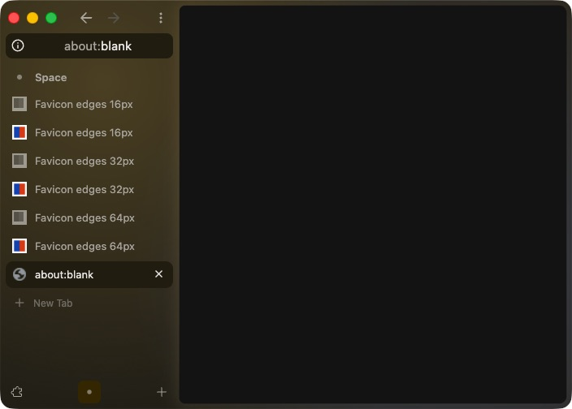
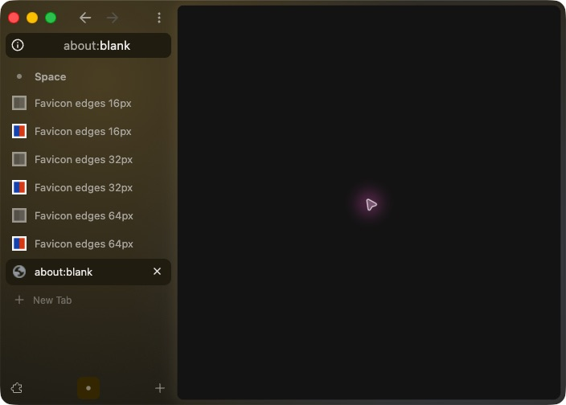

# Complete gray favicon framing

Core PR21 merged as `9bfca487e53d0103a9e9264ec709158afeb69078`.
Its tree exactly matches reviewed head
`69187427f58b40ce7c176619f2e09f3343d8a06d`. Its two changed patch files are
byte-identical to verified `7f2e3677`. The temporary compatibility variant and
its browser-runner migration were dropped in favor of main's repairs. The CI
fixture-list repair is already present in main.

[Astra approved this reconciliation](astra-main-reconciliation-review.md).
The 18 hunks composing the persistent-tab test file matched exact context in
memory. This is a focused source check, not a full catalog replay or build.
The macOS PR now starts at published outer main `bfc058e2` and pins that
published core merge. The obsolete appearance GN context refresh was dropped; all
macOS product patches match published main. Shared156 remains owned by
Runtime SDK. Daniel approved the visible fix and merge; the macOS pin update
awaits final CI. No fresh build or native run is implied by this approval.
[Astra also approved the outer reconciliation](astra-outer-reconciliation-review.md).

The build, test and native evidence below is historical proof for outer
`c28bf9a` / core `7f2e3677`, not a build or native run of `69187427`.

Hibernated tabs used the enlarged destination dimensions as the source crop.
At 110% interface scale, a 16-DIP image was sampled as an 18-DIP source.
The correction samples the full image using `icon.width()` and `icon.height()`.
Destination size, filtering, grayscale and opacity stay the same.

These are unedited native app screenshots from the same isolated profile.
Each pair contains a hibernated gray icon followed by its colored reference.
The fixture artwork has a white border and blue/red center, supplied as
16-, 32- and 64-pixel PNGs by a local HTTP fixture.

| 110% before | 110% after |
| --- | --- |
|  |  |

The [125% before](before-125.jpg) and [125% after](after-125.jpg) screenshots
show the larger scaling case. The [100% smoke check](after-100.jpg) also
retains the complete border and center framing.

The app quit normally and relaunched on the same isolated profile. All six
fixture tabs and cached icons, the active blank page, 704x504 window and 110%
scale restored. See the [restored scene](persistence-restored.jpg). No new
matching crash reports or fatal log markers were observed.

## Historical automated proof

- The rendered regression ran and failed before the production change.
- The identical regression source passed after the one-line correction.
- All 29 `PersistentTabViewTest.*` cases passed, with retries disabled.
- The new case checks 36 combinations of logical source size, destination
  size and 1x/2x display scale. It checks four corners, gray opacity and
  one exterior transparent pixel. Already-gray inputs exercise framing and
  opacity; they do not independently test desaturation.
- The optimized `chrome` and `arcium_feature_settings_unit_tests` targets built.
- Settings `build_ts` and `lint` passed. All 588 patches applied strictly,
  with no pending timestamp snapshot or reported source problems.

[Machine-readable test results](rendered-test-results.json) include source
and binary hashes and the actual compiled revisions.

The additional `arcium_feature_settings_browser_tests` build compiled the
18 migrated browser-chrome cases. It did not link because unchanged Peek
and command-workshop tests refer to removed Chromium APIs. Those browser
tests were not run.

## Historical build provenance

The corrected optimized app was built from outer commit
`c28bf9a280e5853a01c033f57adefcfe031e82ec` and core commit
`7f2e3677b5f66c5390c99dbe72caefd6c1e42297`, with fingerprint
`c89767e8af46dd92842b9a2739a236696827d9441acccfbb19b137e004adcbd5`.
The subsequent evidence-only commits at that historical stage did not change
product sources. The later main reconciliation introduces a different base
and has not received fresh build or native validation here.

The preserved baseline binary was built from outer `c9386c0a` and core
`fd7c9080`. Its six relevant favicon paint, gray styling, sidebar sizing and UI-scale
owner patches are byte-identical to the unfixed Chromium156 base. The entire
baseline tree is not identical; it also contains PiP and test changes. Both app snapshots embed all 530 component
libraries. Their 549 Mach-O files passed dependency closure and deep signature
verification. The fixed runtime also passed snapshot hash checks and loaded
no shared build-output libraries.

Imported favicon artwork can retain up to 64 pixels, enough for the supported
125% interface scale with 2x resources when the original is available. Normal
live-navigation icons can still use 16/32-pixel representations, which may
enlarge slightly. That affects sharpness separately from this crop correction.

[Astra reviewed the verified change](astra-review.md) and found no blocking
production defect. The original review kept the PRs as drafts pending compatibility-parent
reconciliation. That core parent is now superseded by merged main; current
both private main reconciliations are complete. Daniel subsequently approved
merging; the core merge tree is identical to the reviewed head.

The later CI-only core commit `7d8def783403a7be11a1b12714276e180f6312fc` adds five Settings input paths
to the existing lite-source fixture restorer. Its seven restoration tests
passed. It changes no product patches; the compiled revisions above remain
the actual native and rendered-test provenance.

[Astra approved the CI-only follow-up](astra-ci-review.md) after those tests.
The download ref is the selected release tag; there is no expected per-file
hash verification or immutable-commit binding.
