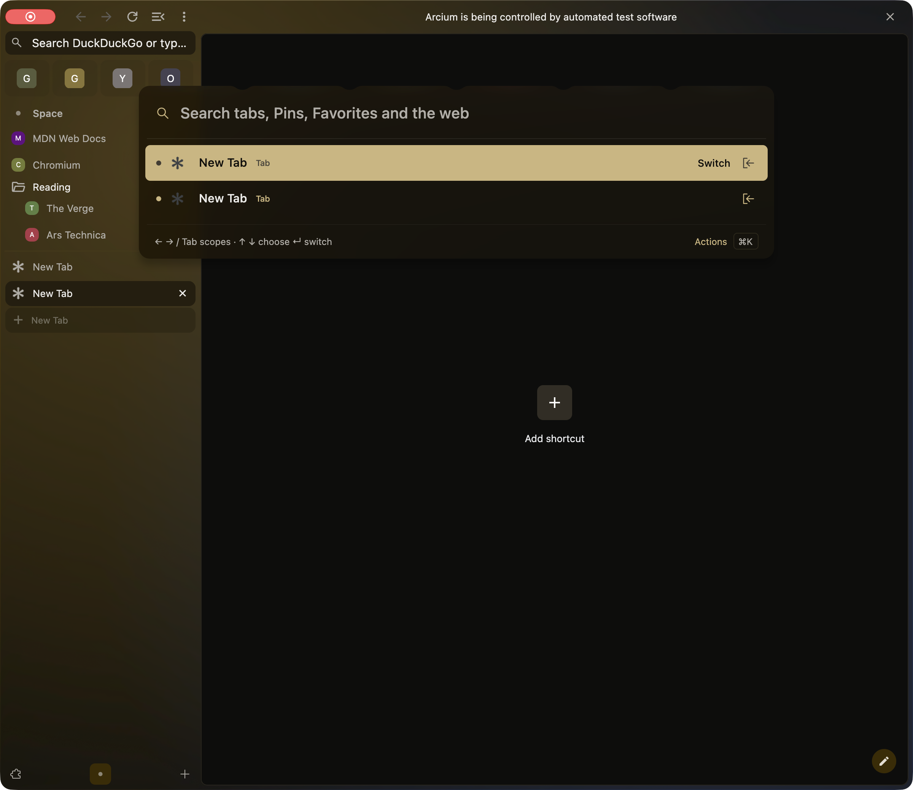
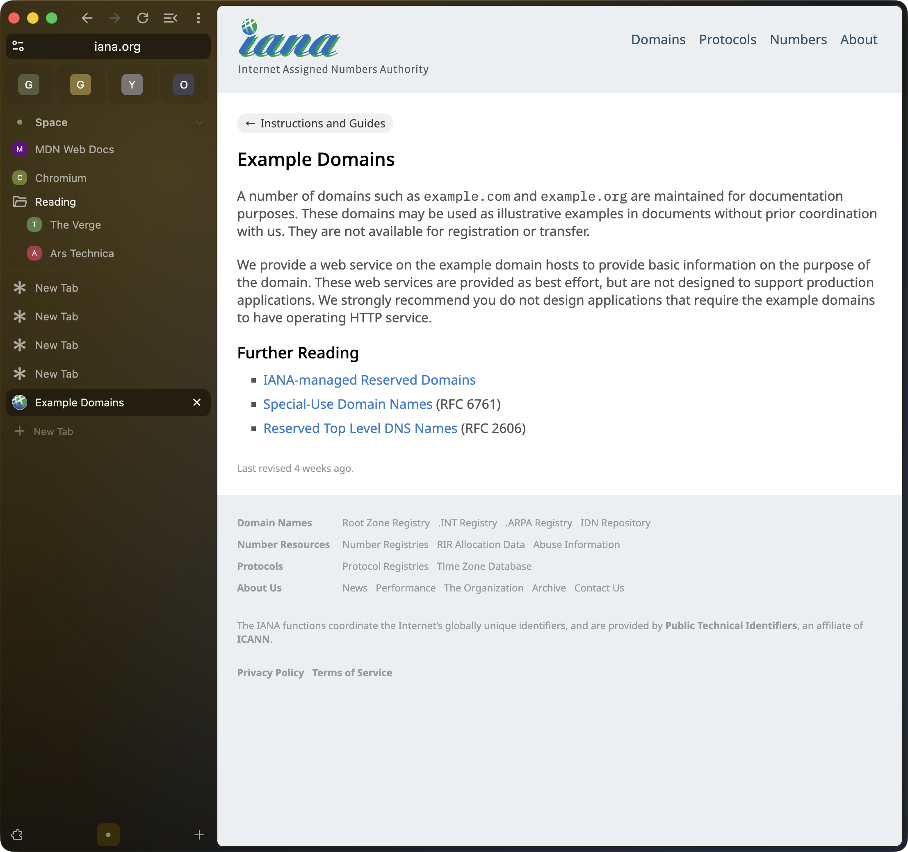

# New Tab and window dragging verification

Tested on macOS 26.6.2, arm64, with outer `c5cd3f3` and core `a50c6e58`.
The later evidence commit changes documentation only. [Build identity](build.json)
records the exact bundle, isolated profile, flags, executable hash, and build run.

[Watch the 34-second native interaction recording](interactions.mp4).
The video contains actual window-only capture. It follows the window, so the
recorded desktop bounds below establish movement. No other apps were captured.

## Results

- Inspected: both entry paths, command-bar ownership, infobar hit testing, and content-frame geometry. Independent Astra review is GO after corrections.
- Replayed: all 530 combined patches and all 521 standalone drag patches applied with zero fuzz. Both patch validators passed.
- Compiled: `chrome`, `arcium_omnibox_unit_tests`, and `arcium_feature_settings_unit_tests` in the daily configuration.
- Automated behavior: 255 command-bar tests and 20 browser-chrome/settings tests passed, with no retries.
- Packaged: ad hoc signed `Helium Dev - new-tab-window-drag.app`, with 540 copied component libraries. Strict bundle signature verification passed; its executable hash matches the source bundle.
- Launched: that independent copy with isolated profile `new-tab-window-drag`, mock Keychain, and `--enable-automation`.
- Native behavior: GPT-6.1 Sol drove the button, shortcuts, command bar, banner, page, split panes, resize edge, and fullscreen. The affected interactions passed.
- Persistence: the same profile retained its four seeded saved identities and resized window geometry after normal quit and relaunch.
- Teardown: the normal Quit menu exited the original process. Relaunch used the same copied bundle and flags. The final app remains open as PID 28018 in a normal single-pane window, with the command bar closed.

The command-bar sequence started with five sidebar tab rows, including four
saved rows. Sidebar New Tab increased that to six; Escape left six. Cmd+T and
two repetitions increased it to seven, eight, and nine. Accepting a URL left
nine. A further Cmd+T produced ten; choosing an existing live result switched
to that tab and left the new blank tab intact at ten.

| Native drag | Before `(x, y, width, height)` | After |
| --- | --- | --- |
| Empty automation banner | `(264, 33, 1200, 1040)` | `(344, 33, 1200, 1040)` |
| Single-pane content-top strip | `(354, 33, 1107, 1040)` | `(274, 33, 1107, 1040)` |
| Right split pane active | `(334, 63, 1107, 1040)` | `(254, 63, 1107, 1040)` |
| Left split pane active | `(254, 63, 1107, 1040)` | `(314, 63, 1107, 1040)` |

The single-pane drag started at screen y=38, one pixel above the webpage's
y=39 boundary. Clicking the page's public link still navigated normally.
The physical banner Close button worked with the browser frontmost.
Right-edge resizing changed width from 1200 to 1107; fullscreen entry and
exit preserved the normal window geometry.

## Limits and review notes

Native stacked layout was not exercised: `SplitViewHorizontal` is disabled by
default and its toggle was absent with these launch flags. The deterministic
stacked-pane test passed with each pane active. The real automation banner
exposed only Close; generic label, OK, Cancel, and dismiss hit tests passed in
C++. Windows and Linux were not tested.

Temporary-session restoration was not established. This profile reopened a
New Tab on startup; the persistence result above covers saved identities and
window geometry. The New Tab cancellation checks apply to the running session.

The system disk filled during console logging. The final build returned success,
and its raw phase logs and exit record remain on the build volume. Telemetry
marks only the console-output stream incomplete. No unrelated files were removed.

See [the native report](native-report.json) for exact steps, counts, bounds,
and resolved coordinate/focus false alarms. Manual review can use the copied
app's `launch.command` beside its runtime directory; that launcher retains the
recorded profile and mock Keychain flags.
